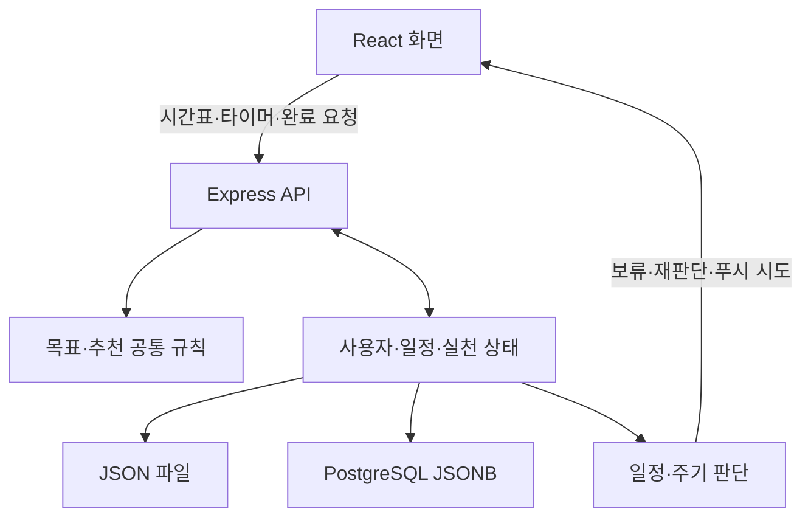

# 시작점 · HY_Lab

**대학생이 수업 사이에 짧은 움직임을 실천하고, 자신의 일어나기 목표와 좌식 기록을 돌아보도록 돕는 웹앱입니다.**

강의실에서 과제를 하거나 도서관에서 공부할 때는 휴식 알림이 와도 바로 일어나기 어렵습니다. 시작점은 시간표에 등록한 수업 중에는 휴식 알림을 보류하고, 수업이 끝나면 현재 기록을 다시 확인해 안내합니다. 사용자는 장소와 남은 시간에 맞는 동작을 선택하고 실천 기록을 남깁니다.

건양대학교 창의설계 팀 프로젝트입니다. 이 문서는 2026년 11월 27일 저장소 `main`의 `90b2cd5`와 소스 기준 `d9d8da2`를 확인해 작성했습니다.

[실행 방법](#실행-방법) · [기술과 데이터 흐름](#기술과-데이터-흐름) · [검증 결과](#검증-결과와-남은-작업) · [팀 기여](#팀과-개인-기여) · [상세 문서](#상세-문서)

## 배경과 해결할 문제

대상 사용자는 수업·과제·자율학습을 이어가는 대학생입니다. 특히 수업 중에는 움직임을 미루고 쉬는 시간이 되어도 공부를 계속하는 상황에 주목했습니다. 이 불편의 빈도와 크기는 사용자 조사로 확인할 문제 가설이며, 현재 조사 결과 수집은 준비 단계입니다.

| 사용 상황과 불편 | 설계한 해결 방법 | 확인할 결과 |
| --- | --- | --- |
| 강의 중 알림을 받아도 움직이기 어려움 | 시간표에 따라 보류하고 종료 후 재판단 | 수업 방해 응답, 종료 후 알림 표시 |
| 장소·가능한 시간에 맞는 행동을 고르기 어려움 | 장소·가용 시간·제외 운동에 따른 후보 추천 | 운동 선택 성공, 선택 과정의 불편 |
| 하루 목표를 어떻게 정할지 어려움 | 예정 좌식시간·시간표에 따른 목표 범위 | 목표 이해도와 실천 기록 |
| 실천 여부를 기억하거나 돌아보기 어려움 | 운동 종류·지속시간·직전 좌식시간 저장 | 완료 기록과 캘린더 조회의 일치 |

[배경·기능 선택 근거와 사용자 질문지](evidence.md)

## 사용 흐름

1. 계정을 만들고 좌식 타이머를 켭니다.
2. 수업 시간표를 등록하고 일정별 무음 여부를 설정합니다. ICS 일정도 가져올 수 있습니다.
3. 휴식 주기에 도달하면 안내를 받습니다. 무음 수업 중이면 보류합니다.
4. 수업이 끝나면 보류 상태를 다시 확인합니다. 그사이 움직였거나 타이머를 끄면 보류를 취소합니다.
5. 현재 장소·가능한 시간에 맞는 운동을 고르고 완료를 기록합니다.
6. 오늘 일어나기 목표와 캘린더·통계에서 기록을 돌아봅니다.

[주요 화면 코드](client/src/pages/Home.tsx) · [시간표 화면 코드](client/src/pages/Timetable.tsx)

## 주요 기능과 구현 상태

아래 표의 구현은 코드 확인 기준입니다. 실제 기기 시험과 효과 측정의 진행 상황은 검증 항목에서 확인할 수 있습니다.

| 기능 | 현재 구현 | 근거 |
| --- | --- | --- |
| 계정 | 이메일 가입·로그인, 제공자 키 설정 시 소셜 로그인 | [API](server/api.ts), [OAuth](server/oauth.ts) |
| 좌식 기록 | 타이머 켜기·끄기, 누적·연속 시간, 추정·사용자 확인·미확인 구간 | [저장·집계](server/db.ts) |
| 시간표 | 요일·날짜별 수업 등록·수정·삭제, ICS 가져오기 | [화면](client/src/pages/Timetable.tsx), [ICS](server/ics.ts) |
| 휴식 알림 | 주기 도달 안내, 수업 중 보류, 종료 후 재판단, 보류 취소 | [앱 내 처리](client/src/pages/Home.tsx), [푸시](server/push.ts) |
| 운동 추천 | 장소·가용 시간·활동 수준·부담 부위·제외 운동·완료 이력 반영 | [추천 규칙](shared/scoring.ts) |
| 실천 기록 | 운동 ID·지속시간·직전 좌식시간 저장, 앉아서 한 동작 별도 집계 | [완료 기록](server/db.ts) |
| 개인 목표 | 예정 좌식시간·사용자 목표 반영, 최근 7일 기반 상향 제안 | [목표 계산](shared/scoring.ts), [요약](server/db.ts) |
| 기록 조회 | 캘린더, 기간별 좌식시간·움직임 횟수, 최장 연속 좌식시간, 부종 자가 기록 | [화면](client/src/pages/Home.tsx) |
| 데이터 보존 | 기본 JSON 파일, 선택적으로 PostgreSQL 저장 | [DB](server/db.ts) |

### 목표와 추천 기준

- 핵심 목표는 **일어나기 인정 횟수 / 개인 목표**입니다. 최신 공통 계산에서는 목표 달성과 활동 시간을 집계합니다.
- 예정 좌식시간에 따라 목표 범위를 계산하고 사용자가 정한 목표를 반영합니다. 일어나기 인정에는 30분 중복 집계 제한을 적용합니다. 앉아서 한 동작은 별도 기록합니다.
- 최근 7일 중 기록일이 5일 이상이고 해당 기록일 모두 목표를 달성하면, 현재 목표가 권장값보다 낮을 때 1회 상향을 제안합니다. 사용자가 목표 변경을 선택합니다.
- 추천 후보는 장소·가용 시간·사용자 제외·부담 부위로 거르고 활동 수준과 완료 이력에 따라 정렬합니다. 후보의 추천 이유와 제외 사유를 계산합니다.

이 수치와 우선순위는 현재 제품의 설계 규칙입니다. 실제 자세와 활동은 타이머·사용자 입력에 의존하며, 측정 가능한 효과는 아래 사용 시험으로 확인할 예정입니다.

## 기술과 데이터 흐름

| 계층 | 기술·역할 |
| --- | --- |
| 화면 | React, TypeScript, Vite, Tailwind CSS |
| API | Node.js, Express |
| 공통 규칙 | `shared/scoring.ts`의 목표·추천·활동량 계산 |
| 상태와 저장 | 서버 메모리 상태를 JSON 파일 또는 PostgreSQL JSONB로 저장 |
| 알림 | 앱 내 안내, 브라우저 Notification, Service Worker·Web Push |



저장 경로는 `DATABASE_URL` 설정 여부에 따라 결정됩니다. 기본 파일은 `server/data/db.json`입니다. PostgreSQL 설정 시 `app_state` 테이블에 전체 상태를 저장하고 약 300ms의 변경을 묶어 순서대로 반영합니다. 현재 저장 구조는 소규모 단일 서버 프로토타입을 전제로 합니다.

앱은 타이머 사용 중 약 15초마다 기록을 동기화합니다. 운동 완료 시 API가 기록을 저장하고 오늘의 실천·목표 요약을 반환합니다. 서버 푸시는 구독 사용자를 대상으로 20초마다 일정과 휴식 주기를 확인합니다.

휴식 주기 알림은 수업 중 보류 후 재판단합니다. 별도로 등록한 지정 시각 알림은 해당 시각이 무음 일정이면 건너뛰는 흐름이므로 두 알림을 구분해 시험해야 합니다.

| 대표 API | 처리 |
| --- | --- |
| `POST /api/auth/signup`, `POST /api/auth/login` | 가입·로그인 |
| `GET /api/dashboard/:id` | 좌식·실천·목표 요약 |
| `POST /api/heartbeat` | 좌식시간 동기화 |
| `POST /api/movements` | 운동 완료 기록 |
| `PUT /api/users/:id/today` | 오늘 목표·예정 좌식시간 설정 |
| `POST /api/users/:id/schedule/import` | ICS 일정 가져오기 |

[기술 구성과 처리 흐름 상세](design.md)

## 기존 서비스와의 비교

| 비교 관점 | Workrave | Time Out | 시작점 |
| --- | --- | --- | --- |
| 휴식 안내 | 입력장치 사용 기반의 짧은·긴 휴식 | Mac 휴식과 일정·사용 상황별 규칙 | 대학생 시간표·좌식 타이머 |
| 일정에 따른 알림 조절 | 확인한 개요에서 캘린더 상세 미확인 | 캘린더 이벤트·앱·집중 모드에 따른 연기·건너뛰기 | 시간표·ICS의 무음 일정, 수업 종료 후 재판단 |
| 실천을 돌아보기 | 사용시간, 휴식·무시·연기 통계 | 확인한 개요의 상세 통계 범위 미확인 | 동작·시간·일어나기 목표·캘린더 기록 |
| 장소·가용 시간별 운동 후보 | 확인한 개요에서 미확인 | 확인한 개요에서 미확인 | 입력 조건과 완료 이력에 따른 규칙 추천 |

기존 제품에도 일정 반영과 휴식 기록 기능이 있습니다. 시작점은 **대학생 시간표 → 가능한 운동 선택 → 일어나기 목표와 실천 기록**을 연결한 사용 흐름을 중심으로 검토합니다. 이 결합의 사용 편의성과 효과는 소규모 시험으로 확인할 예정입니다.

비교는 2026-11-27 공식 공개 안내 기준이며 직접 설치 비교는 미실시입니다. 미확인 표기는 확인한 자료의 범위를 뜻합니다. [Workrave 공식 안내](https://workrave.org/) · [Time Out 공식 안내](https://dejal.com/timeout/)

[비교 근거와 갱신 기준](comparison.md)

## 기대효과와 측정 계획

기대하는 변화는 수업 방해를 줄이고 가능한 시점에 움직임을 실천하도록 돕는 것입니다. 현재 사용자 조사와 비교 결과는 수집 전입니다.

학생 팀이 수행할 탐색 시험으로 참여자 4명이 고정 주기 알림과 일정 반영 알림을 각 1일씩 사용하도록 제안했습니다. 두 명은 고정→일정 반영, 두 명은 반대 순서로 진행하고 관찰 시간과 동작·목표 조건을 맞춥니다. 참여 인원과 기간은 시험 시작 전 팀에서 확정합니다.

| 지표 | 계산·확인 방법 |
| --- | --- |
| 알림 후 실천율 | 실제 표시한 고유 알림 중 5분 이내 완료한 비율. 무응답 포함 |
| 수업 방해율 | 표시된 고유 알림 중 수업을 방해했다고 답한 비율 |
| 관찰 시간당 실천 | 관찰 구간의 실천 수 / 유효 관찰 시간 |
| 최장 연속 좌식시간 | 같은 관찰 구간에서 앱이 기록한 최대값 |
| 사용성 의견 | 운동 선택·완료·기록 조회에서 어려웠던 점 |

5분은 제안한 제품 평가 설정입니다. 표시된 알림이 0건이면 실천율은 계산 불가로 기록합니다. 하나의 완료 기록은 알림 한 건에 연결하고 자발적 실천은 별도로 셉니다. 미확인 구간을 좌식 0분으로 간주하지 않습니다.

현재 알림별 발송·실제 표시·응답을 연결한 저장은 보강이 필요하므로 초기 시험은 관찰자 수기 기록을 병행할 수 있습니다. 결과에는 개인별 표시 수·실천 수·관찰 시간·조건 순서를 함께 남깁니다. 적은 인원과 짧은 기간에서 관찰한 행동·사용성 변화로 보고합니다.

[사용자 질문지](evidence.md) · [조건·지표·기록 양식](evaluation.md)

## 팀과 개인 기여

| 계정 | 확인한 작업 | 근거 |
| --- | --- | --- |
| [month21](https://github.com/month21) | 초기 프로토타입, 타이머·캘린더 수정, 스트레칭 카드 수정 | `8827c2d`, [PR #1](https://github.com/KYU-SW/HY_Lab/pull/1), [PR #2](https://github.com/KYU-SW/HY_Lab/pull/2) |
| [songhb2005](https://github.com/songhb2005) | 로그인·타이머·캘린더 관련 PR 개설·병합, 이후 화면·서버·공통 규칙 업데이트 커밋 | [PR #3](https://github.com/KYU-SW/HY_Lab/pull/3), [개발 이력](https://github.com/KYU-SW/HY_Lab/commits/main/) |

표는 공개 커밋·PR에서 확인한 작업입니다. 실명과 계정 대응, 기획·시험·문서 작업의 개인별 담당과 공동 작업 범위는 팀원 확인 대기 상태입니다. 기여 문서에 산출물과 확인자를 연결하도록 구성했습니다.

이번 평가 보완 문서 초안 작성에는 ChatGPT를 활용했습니다. 팀이 근거·담당·시험 결과를 검토해 제출 내용을 확정합니다. [상세 기여와 AI 활용 기록](contributions.md)

## 실행 방법

저장소 **루트**에서 실행합니다. 내부 `HY_Lab/`에도 이전 복사본이 있으므로 최초 clone 뒤 한 번 `cd HY_Lab`한 위치의 `package.json`을 사용합니다.

Node.js 22.12 이상과 npm을 권장합니다. 실제 타입 검사·빌드는 Node.js 24.22.3에서 확인했습니다.

```bash
git clone https://github.com/KYU-SW/HY_Lab.git
cd HY_Lab
npm ci --legacy-peer-deps
npm run dev
```

현재 Vite 7과 `@builder.io/vite-plugin-jsx-loc`의 peer dependency 범위 차이 때문에 일반 `npm ci`에서 `ERESOLVE`가 발생해 위 옵션을 사용했습니다.

개발 화면은 기본 `http://localhost:3000`, API는 `http://localhost:4000`입니다. Vite가 `/api` 요청을 Express로 전달합니다. 화면 포트가 사용 중이면 Vite 실행 로그에 나온 주소를 확인합니다.

### 환경변수

기본 이메일 가입·로그인과 JSON 저장은 외부 계정 키 없이 시작할 수 있습니다. 변수는 호스팅 설정이나 서버를 실행하는 셸에 전달합니다. 현재 서버 코드에는 `.env`를 자동 로드하는 설정이 없습니다.

| 변수 | 용도 |
| --- | --- |
| `DATA_DIR` | JSON 저장 폴더. 기본 `server/data`, 파일명 `db.json` |
| `DATABASE_URL` | 선택. PostgreSQL 연결 문자열. 설정 시 시작 단계에서 테이블 생성·읽기 |
| `API_PORT` | 개발 API 포트. 기본 `4000`, Vite 프록시와 함께 적용 |
| `PORT` | 운영 서버 포트. 기본 `3000` |
| `VAPID_SUBJECT` | Web Push 연락처 URI. 기본 `mailto:admin@example.com` |
| `PUBLIC_BASE_URL` | 외부 기본 주소. OAuth 콜백 주소에 사용 |
| `GOOGLE_CLIENT_ID` | Google 로그인 사용 시 설정 |
| `KAKAO_REST_API_KEY`, `KAKAO_CLIENT_SECRET` | Kakao 앱 키와 제공자 설정에 따른 secret |
| `NAVER_CLIENT_ID`, `NAVER_CLIENT_SECRET` | Naver 로그인 설정 |
| `APPLE_CLIENT_ID`, `APPLE_TEAM_ID`, `APPLE_KEY_ID`, `APPLE_PRIVATE_KEY` | Apple 로그인 설정 |

소셜 로그인은 제공자 콘솔의 앱·콜백 주소 설정이 필요합니다. 푸시는 HTTPS 또는 localhost, 지원 브라우저, 알림 권한과 구독이 필요하며 실제 기기에서 수신을 확인해야 합니다. 데이터 파일·개인 계정 정보·비밀키는 공개 업로드에서 제외합니다.

### 타입 검사·빌드·운영

```bash
npm run check
npm run build
npm start
```

`npm start`는 Express가 API와 `dist/public`의 화면을 함께 제공합니다. `npm run preview`는 Vite 화면 미리보기이며 API는 별도로 실행해야 합니다.

## 검증 결과와 남은 작업

| 항목 | 상태·근거 |
| --- | --- |
| 타입 검사 | 2026-11-27, 소스 `d9d8da2`, Node.js 24.22.3에서 성공. [로그](verification/typecheck.log) |
| 프로덕션 빌드 | 같은 조건에서 성공, 화면·서버 번들 생성. [로그](verification/build.log) |
| 기능 시험 | 가입·좌식 기록·완료·수업 보류 등 13개 시험 절차 작성, 실제 결과 기입 대기 |
| 자동 스모크 테스트·CI | 구현 예정 |
| 기기별 푸시 시험 | 미실행 |
| 사용자 조사·효과 비교 | 계획 작성, 결과 미수집 |
| 중복 폴더 | 차이 확인·정리 절차 작성, 실제 삭제와 배포 경로 확인 대기 |

빌드 성공은 번들 생성 확인입니다. 로그인부터 실천 기록까지의 정상 동작은 별도 기능 시험으로 확인합니다. [실행 환경·기능별 시험 절차](test-results.md)

스모크 테스트는 시험 계정 생성 → 로그인 → 타이머 기록 → 운동 완료 → 조회 흐름으로 구현할 예정입니다. 임시 데이터 폴더·별도 포트에서 실행하고, 수업 중 보류와 보류 중 움직임 취소도 검증합니다. 알림별 표시·응답 기록과 방식별 실천율 저장 역시 후속 보완 항목입니다.

## 폴더 구성과 실행 기준

| 경로 | 역할 |
| --- | --- |
| `client/src/pages/` | 주요 앱·시간표 화면 |
| `client/src/lib/api.ts` | API 호출과 응답 타입 |
| `server/api.ts` | 계정·기록·목표·일정 API |
| `server/db.ts` | 저장·조회·집계 |
| `server/push.ts` | 푸시와 보류 알림 |
| `server/ics.ts`, `server/oauth.ts` | 일정 가져오기·소셜 로그인 |
| `shared/scoring.ts` | 운동 목록·목표·추천 공통 규칙 |
| 루트의 `*.md`, `verification/` | 프로젝트·평가 근거 문서와 실행 로그 |
| 내부 `HY_Lab/` | 이전 중첩 복사본, 비교·정리 대상 |

루트와 중첩본에는 서로 다른 코드가 있습니다. 최신 기능 검토와 위 실행 안내는 루트를 기준으로 작성했습니다. 실제 배포의 Root Directory·Build Command·Start Command를 확인하고 중첩본에 필요한 수정이 있는지 비교한 뒤 정리합니다. 배포 설정 확인은 아직 진행 전입니다. [역할 정의·차이·정리 절차](repository-structure.md)

## 상세 문서

현재 저장소에 올라간 루트 경로를 기준으로 연결했습니다.

| 문서 | 내용 |
| --- | --- |
| [evidence.md](evidence.md) | 대상·문제 가설·기능 선택 이유·사용자 질문지 |
| [design.md](design.md) | API·저장·알림·추천 흐름 |
| [comparison.md](comparison.md) | 공식 자료 기반 유사 앱 비교 |
| [contributions.md](contributions.md) | 계정별 작업·팀원 확인·AI 활용 |
| [evaluation.md](evaluation.md) | 소규모 시험 조건·지표·기록 양식 |
| [test-results.md](test-results.md) | 실행 결과와 기능 시험 절차 |
| [repository-structure.md](repository-structure.md) | 중복 폴더 역할과 정리 절차 |
