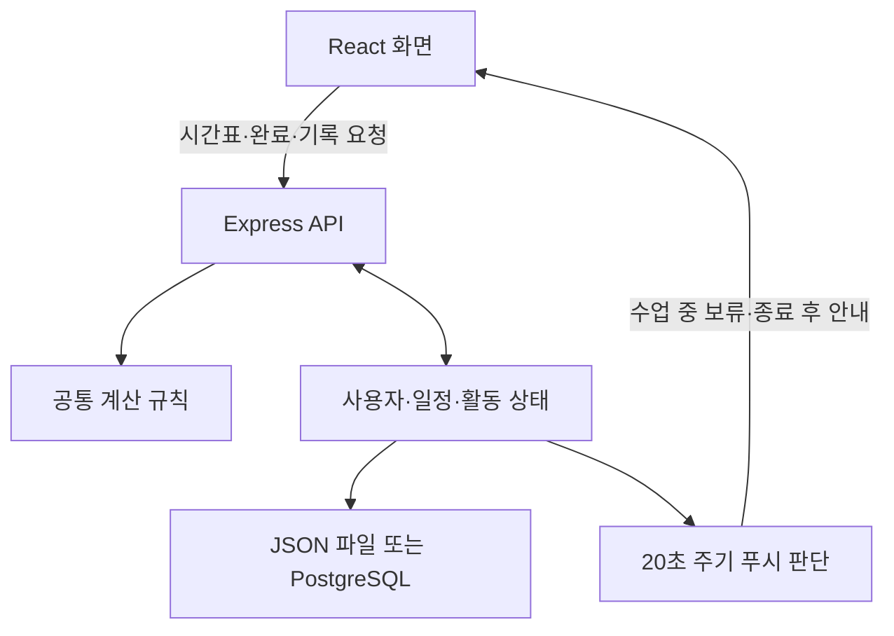

# 시작점 · HY_Lab

**대학생의 시간표에 맞춰 짧은 움직임을 실천하고, 일어나기 목표와 좌식 기록을 돌아보는 웹앱입니다.**

강의와 과제를 이어가다 보면 오래 앉아 있어도 움직일 시점을 놓치기 쉽습니다. 시작점은 사용자가 등록한 수업 시간에는 휴식 알림을 보류하고, 일정이 끝나면 다시 안내합니다. 장소와 가용 시간에 맞는 동작을 고르고 완료 기록을 남겨, 하루의 실천을 확인하도록 만들었습니다.

건양대학교 창의설계 팀 프로젝트입니다. 이 README는 2026년 11월 27일 루트 소스 커밋 `d9d8da2`를 기준으로 작성했습니다.

[주요 화면 코드](client/src/pages/Home.tsx) · [시간표 화면](client/src/pages/Timetable.tsx) · [변경 이력](https://github.com/KYU-SW/HY_Lab/commits/main/) · [팀 PR](https://github.com/KYU-SW/HY_Lab/pulls?q=is%3Apr)

## 사용 흐름

1. 계정을 만들고 좌식 타이머를 켭니다.
2. 수업 시간표와 무음 여부를 등록합니다. ICS 캘린더도 가져올 수 있습니다.
3. 휴식 주기에 도달하면 움직임 안내를 받습니다. 무음 일정 중에는 안내를 보류합니다.
4. 장소·가능한 시간·선호 범주에 맞는 운동을 선택하고 완료를 기록합니다.
5. 오늘 일어나기 목표, 캘린더와 기간별 기록에서 실천을 돌아봅니다.

## 현재 구현 범위

아래는 소스에서 확인한 구현 범위입니다. 실제 기기 검증 결과는 아래 검증 항목에서 확인할 수 있습니다.

| 영역 | 동작 | 관련 코드 |
| --- | --- | --- |
| 계정 | 이메일 가입·로그인, 별도 설정 시 Google·Kakao·Naver·Apple 로그인 | [API](server/api.ts), [OAuth](server/oauth.ts) |
| 좌식 기록 | 타이머 켜기·끄기, 연속·누적 시간, 추정·사용자 확인·미확인 구간 구분 | [저장 및 집계](server/db.ts) |
| 시간표 | 수업 등록·수정·삭제, 요일·날짜별 일정, ICS 가져오기 | [화면](client/src/pages/Timetable.tsx), [ICS 처리](server/ics.ts) |
| 휴식 알림 | 주기 도달 안내, 수업 중 보류, 종료 후 재판단, 움직임·타이머 중지에 따른 보류 취소 | [앱 내 알림](client/src/pages/Home.tsx), [푸시](server/push.ts) |
| 운동 추천 | 장소·가용 시간·활동 수준·제외 운동·입력한 신체 부담 부위·완료 이력을 이용한 규칙 추천 | [추천 함수](shared/scoring.ts) |
| 실천 기록 | 운동 종류·지속 시간·직전 좌식시간 저장, 앉아서 한 동작과 일어나서 한 동작 구분 | [기록 처리](server/db.ts) |
| 개인 목표 | 예정 좌식시간·시간표를 이용한 목표 범위, 직접 목표 설정, 최근 7일 기록을 이용한 상향 제안 | [공통 계산](shared/scoring.ts), [오늘 집계](server/db.ts) |
| 돌아보기 | 캘린더, 일·주·월 통계, 최장 연속 좌식시간, 부종 자가 기록 | [화면](client/src/pages/Home.tsx), [통계](server/db.ts) |
| 저장 | 기본 JSON 파일 저장, `DATABASE_URL` 설정 시 PostgreSQL 저장 | [DB](server/db.ts) |

### 목표와 추천의 계산 기준

- 오늘의 핵심 목표는 **일어나기 인정 횟수 / 개인 목표**입니다. 최신 공통 계산은 일어나기 횟수와 활동 시간을 집계합니다.
- 예정 좌식시간에 따라 목표 범위를 계산하고, 사용자 목표를 반영합니다. 일어나기 인정은 30분 중복 집계 제한을 적용합니다. 앉아서 한 동작은 별도 실천 기록으로 남깁니다.
- 최근 7일 중 기록한 날이 5일 이상이고 해당 기록일 모두 목표를 달성하면, 현재 목표가 권장값보다 낮을 때 1회 상향을 제안합니다. 목표 변경은 사용자가 선택합니다.
- 운동 추천은 가능한 후보를 필터링하고 활동 수준과 완료 이력에 따라 순서를 정합니다. 근거 설명과 제외 사유도 함께 계산합니다.
- 타이머 수치는 앱 사용·입력에 따른 기록입니다. 질병 발생 확률이나 예방 효과를 산출하는 기능은 추가 연구와 검증이 필요한 범위입니다.

## 기술과 데이터 흐름

| 계층 | 구성 |
| --- | --- |
| 화면 | React, TypeScript, Vite, Tailwind CSS |
| 서버 | Node.js, Express |
| 공통 규칙 | `shared/scoring.ts`의 목표·활동량·추천 계산 |
| 저장소 | 메모리 상태 + JSON 파일 또는 PostgreSQL `app_state` 테이블 |
| 알림 | 앱 내 안내, 브라우저 Notification, Service Worker와 Web Push |



앱은 좌식 타이머가 켜진 동안 약 15초마다 기록을 동기화합니다. 운동 완료 시 API가 기록을 저장하고 오늘의 목표·실천 요약을 다시 반환합니다. 서버 푸시는 구독 사용자에 대해 일정과 휴식 주기를 확인합니다.

PostgreSQL은 전체 앱 상태를 JSONB로 저장하며 변경을 약 300ms 묶어 순서대로 반영합니다. 현재 저장 구조는 소규모 단일 서버 프로토타입 운영을 전제로 합니다.

## 로컬 실행

아래 명령은 저장소 **루트**에서 실행합니다. 하위 `HY_Lab/`에도 이전 복사본이 있으므로 실행 위치를 확인해 주세요. 현재 루트에는 추가된 추천·목표 계산과 PostgreSQL 저장 코드가 있습니다.

Node.js 22.12 이상과 npm 사용을 권장합니다. 저장소의 Vite 설정에서 `import.meta.dirname`을 사용합니다.

```bash
git clone https://github.com/KYU-SW/HY_Lab.git
cd HY_Lab
npm ci --legacy-peer-deps
npm run dev
```

Vite 개발 화면은 기본 `http://localhost:3000`, Express API는 `http://localhost:4000`입니다. Vite가 `/api` 요청을 Express로 전달합니다. 3000번 포트가 사용 중이면 화면 주소는 Vite 실행 로그에서 확인합니다.

현재 Vite 7과 `@builder.io/vite-plugin-jsx-loc`의 peer dependency 범위 차이로 일반 `npm ci`에서 `ERESOLVE`가 발생합니다. 위 설치 명령에 호환성 옵션을 명시했습니다.

### 환경 설정

기본 이메일 가입·로그인과 JSON 저장은 외부 계정 키 없이 시작할 수 있습니다. 환경변수는 서버 프로세스에 전달합니다. 현재 서버 시작 코드에는 `.env` 파일을 자동 로드하는 설정이 없습니다.

| 변수 | 용도·기본값 |
| --- | --- |
| `DATA_DIR` | JSON 저장 폴더. 기본 `server/data`, 파일명 `db.json` |
| `DATABASE_URL` | 선택. PostgreSQL 연결 문자열. 설정하면 시작 시 `app_state` 테이블 생성·읽기 |
| `API_PORT` | 개발 API 포트. 기본 `4000`, Vite 프록시와 함께 적용 |
| `PORT` | 운영 서버 포트. 기본 `3000` |
| `VAPID_SUBJECT` | Web Push 연락처 URI. 기본 `mailto:admin@example.com` |
| `PUBLIC_BASE_URL` | 외부에서 접속하는 앱 기본 주소. OAuth 콜백 주소 구성에 사용 |
| `GOOGLE_CLIENT_ID` | Google 로그인 사용 시 설정 |
| `KAKAO_REST_API_KEY`, `KAKAO_CLIENT_SECRET` | Kakao 로그인 설정. secret은 제공자 설정에 따라 사용 |
| `NAVER_CLIENT_ID`, `NAVER_CLIENT_SECRET` | Naver 로그인 설정 |
| `APPLE_CLIENT_ID`, `APPLE_TEAM_ID`, `APPLE_KEY_ID`, `APPLE_PRIVATE_KEY` | Apple 로그인 설정 |

기본 파일 저장은 API 시작 시 사용자 데이터와 푸시 키 등을 생성합니다. 운영 시에는 저장 폴더를 지속 보존하고, 데이터 파일·비밀키·계정 정보는 공개 저장소 업로드에서 제외해 주세요. 소셜 로그인은 제공자 콘솔의 앱 설정과 콜백 URL 등록이 필요합니다.

백그라운드 푸시는 HTTPS 또는 localhost, 지원 브라우저, 알림 권한과 푸시 구독이 필요합니다. 모바일 브라우저와 운영체제별 수신 동작은 실제 기기에서 확인해야 합니다.

### 빌드·운영

```bash
npm run check
npm run build
npm start
```

`npm start`는 Express가 API와 `dist/public` 화면을 함께 제공합니다. 운영 환경변수는 호스팅 서비스 또는 실행 셸에서 설정합니다. `npm run preview`는 Vite 화면 미리보기용이며 API 서버는 별도로 필요합니다.

## 검증과 후속 작업

자동화 시험·기기 시험·효과 측정의 진행 상태는 실행 근거와 함께 관리합니다.

| 확인 항목 | 상태 |
| --- | --- |
| 소스의 기능·실행 명령·환경변수 대조 | 2026-11-27 확인 |
| 기본 의존성 설치 | 일반 `npm ci`에서 peer dependency 충돌 확인 |
| 호환성 옵션을 적용한 의존성 설치 | `npm ci --legacy-peer-deps` 성공 |
| 타입 검사·프로덕션 빌드 | Node.js 24.22.3에서 `npm run check`, `npm run build` 성공 (2026-11-27) |
| 로그인부터 운동 완료까지의 자동 스모크 테스트 | 추가 예정 |
| 휴대폰 푸시·수업 종료 후 알림 수신 | 기기별 시험 필요 |
| 고정 알림과 일정 반영 알림의 실천 결과 비교 | 측정 예정 |

수동 확인은 회원가입 → 좌식 타이머 → 무음 일정 → 휴식 주기 도달 → 일정 종료 → 운동 완료 → 캘린더 기록 순서로 진행할 수 있습니다. 실제 시각, 입력값, 예상 결과와 화면을 남겨 재현 여부를 확인합니다.

후속 보완 항목은 알림별 판단·표시·응답 시각의 영속 기록, 알림 방식별 실천율 집계, 자동 스모크 테스트와 CI, 중복 복사 폴더 정리입니다.

### 기대효과 측정 계획

계획 중인 소규모 비교는 참여자가 고정 알림과 일정 반영 알림을 각각 사용하고, 알림 후 5분 이내 실천율·수업 방해 응답·기록된 최장 연속 좌식시간을 비교하는 방식입니다. 실제 표시가 확인된 알림을 실천율의 분모로 하고 무응답을 포함합니다. 5분은 시험 전에 정하는 제품 평가 기준입니다.

현재 알림별 표시·응답 기록을 보강해야 하므로 초기 시험에서는 수기 기록을 병행할 수 있습니다. 참여 인원·사용 기간·순서를 결과에 명시하고, 관찰 결과와 사용자 의견을 함께 보고합니다. 사용자 조사와 효과 측정의 실제 결과는 확보 후 추가합니다.

## 협업 이력

| 계정 | 저장소에서 확인 가능한 작업 |
| --- | --- |
| [month21](https://github.com/month21) | 초기 프로토타입, 타이머·캘린더 수정 [PR #1](https://github.com/KYU-SW/HY_Lab/pull/1), 스트레칭 카드 수정 [PR #2](https://github.com/KYU-SW/HY_Lab/pull/2) |
| [songhb2005](https://github.com/songhb2005) | 로그인·타이머·캘린더 관련 [PR #3](https://github.com/KYU-SW/HY_Lab/pull/3) 병합과 이후 기능 업데이트 커밋 |

위 표는 계정의 커밋·PR에서 확인한 작업입니다. 기획·문서·시험 등 별도 작업의 개인별 내역은 팀원 확인과 산출물 링크를 추가해 보완합니다.

## 소스 위치

| 경로 | 내용 |
| --- | --- |
| `client/src/pages/` | 주요 앱·시간표 화면 |
| `client/src/lib/api.ts` | 클라이언트 API 호출과 응답 타입 |
| `server/api.ts` | 계정·기록·일정·목표 API |
| `server/db.ts` | 기록 저장·조회와 집계 |
| `server/push.ts` | Web Push와 보류 알림 처리 |
| `server/ics.ts`, `server/oauth.ts` | 캘린더 가져오기·소셜 로그인 |
| `shared/scoring.ts` | 운동 목록·추천·목표 공통 계산 |
| `HY_Lab/` | 이전 중첩 복사본. 위 실행 안내는 루트 소스 기준 |
