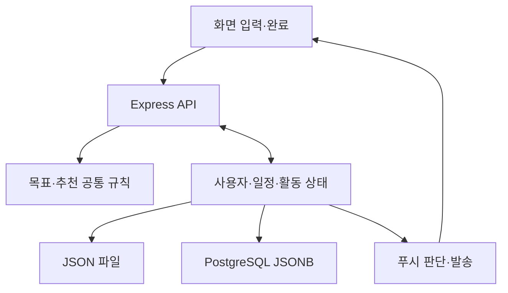

# 기술 구성과 알림·기록 흐름

검토 소스 `d9d8da2` · 작성일 2026-11-27

## 구성

| 계층 | 역할 | 파일 |
| --- | --- | --- |
| React·Vite | 시간표·타이머·운동 선택·실천 조회 | `client/src/pages/Home.tsx`, `Timetable.tsx` |
| Express | 요청 입력 확인·사용자 데이터 접근·응답 | `server/api.ts` |
| 공통 규칙 | 목표·동작 필터·활동량 계산 | `shared/scoring.ts` |
| 저장 | 사용자·일정·활동 상태와 영속화 | `server/db.ts` |
| 푸시 | 구독자별 주기·일정 확인과 발송 시도 | `server/push.ts` |

저장은 `DATABASE_URL` 유무에 따라 JSON 파일 또는 PostgreSQL을 사용한다. PostgreSQL 연결 시 전체 상태를 `app_state`의 JSONB로 저장하며 약 300ms의 변경을 묶고 순서대로 쓴다. 단일 서버의 소규모 프로토타입 구조이며 여러 서버 프로세스 간 동시 갱신은 후속 검토 대상이다.

## 대표 API

| 요청 | 처리 |
| --- | --- |
| `POST /api/auth/signup`, `/api/auth/login` | 계정 생성·로그인 |
| `GET /api/dashboard/:id` | 좌식·무음·실천·목표 요약 |
| `POST /api/heartbeat` | 타이머 사용 중 누적 기록 |
| `POST /api/movements` | 운동 ID·지속시간을 받아 완료 기록 |
| `PUT /api/users/:id/today` | 오늘 목표·예정 좌식시간 설정 |
| `GET /api/users/:id/schedule` | 시간표 조회 |
| `POST /api/users/:id/schedule/import` | ICS 가져오기 |

현재 API는 사용자 ID의 존재를 확인해 데이터를 처리한다. 운영용 세션 인증·다른 계정 데이터 접근 차단 여부는 별도 보안 검토 항목이다. [API 코드](https://github.com/KYU-SW/HY_Lab/blob/d9d8da28441a5acf07a75b3fa9f031b1851ac4f1/server/api.ts)

## 알림 판단

휴식 주기를 넘긴 상태에서 수업 무음 일정이면 보류한다. 이후 무음이 해제되면 보류 상태와 움직임 기록을 확인한다. 보류 사이 움직임이 기록되거나 타이머가 꺼지면 보류를 취소한다. 이 흐름은 앱 내 알림과 서버 푸시 경로에 각각 구현돼 있어 두 경로를 모두 시험해야 한다.

정해진 시각의 알림은 해당 분에 무음이면 건너뛰는 경로다. 휴식 주기 보류와 지정 시각 알림의 동작을 구분해 설명한다. 푸시 스케줄러는 20초 간격이며 실제 도착은 브라우저·운영체제·네트워크 영향도 받는다. [알림 코드](https://github.com/KYU-SW/HY_Lab/blob/d9d8da28441a5acf07a75b3fa9f031b1851ac4f1/server/push.ts)

발송 시도, 기기 표시, 실천 완료를 각각 기록해야 알림별 효과를 계산할 수 있다. 현재 코드의 보류 상태와 완료 기록만으로 알림별 실천율 전 과정을 증명하기는 어려워 통합 기록 보완이 필요하다.

## 목표·추천

목표는 예정 좌식시간과 사용자 설정을 반영한다. 최근 7일의 기록일이 5일 이상이고 모두 달성했다면 조건에 따라 목표 1회 상향을 제안한다. 추천은 장소·시간·사용자 제외·부담 부위로 후보를 거르고 활동 수준·완료 이력으로 정렬한다. 최신 핵심 표시는 일어나기 인정 횟수와 개인 목표다. [공통 계산 코드](https://github.com/KYU-SW/HY_Lab/blob/d9d8da28441a5acf07a75b3fa9f031b1851ac4f1/shared/scoring.ts)
